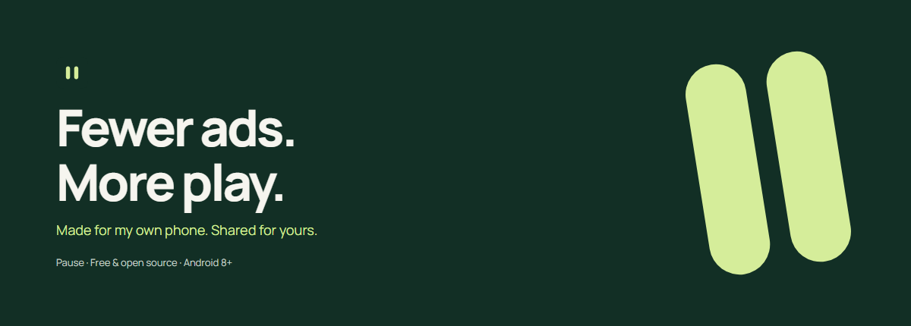
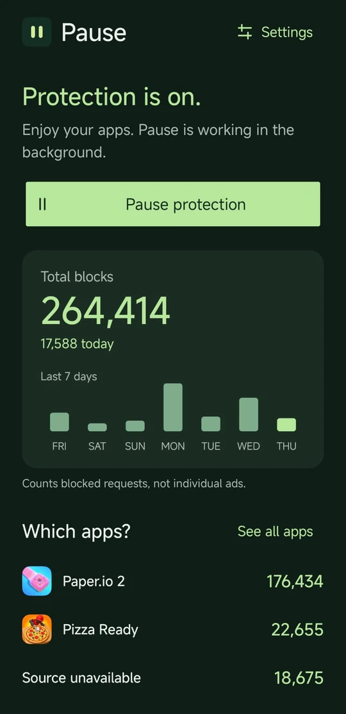
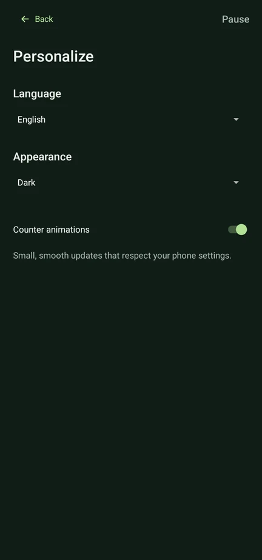
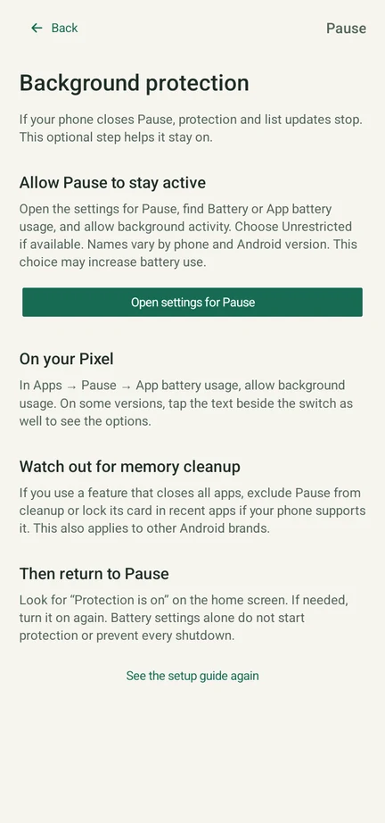
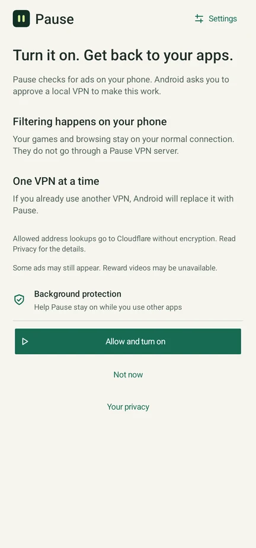
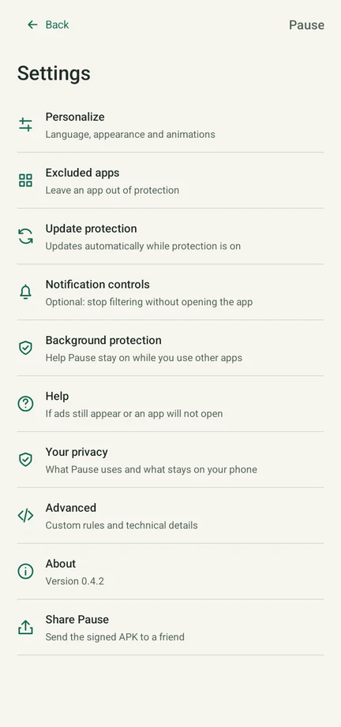
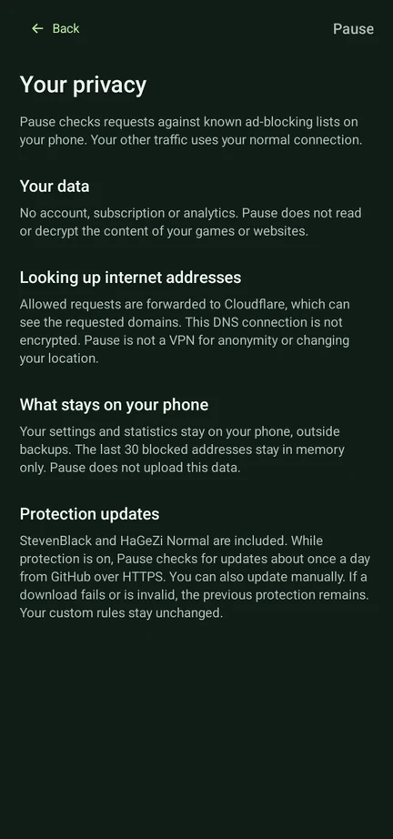

<h1 align="center">Fewer ads. More play.</h1>

A simple, free ad blocker for Android. Turn it on. Get back to your games, apps and browsing.

<strong>Android 8+ · Version 0.4.3 · Free &amp; open source</strong> No account. No subscription. No root.

<a href="https://matteoawi.github.io/Pause/">Visit the website</a> · <a href="https://github.com/matteoawi/Pause/releases/latest">Release notes &amp; checksum</a> · <a href="#get-started">Get started</a> · <a href="SECURITY.md">Security</a>

## Made for my own phone. Shared for yours.

I wanted to enjoy a game without an ad taking over every few moments. So I built **Pause**: one button, clear choices, and no account to get in the way.

It worked well for the games I tried. Now the app and its code are here for anyone to use, inspect and improve. — [Matteo](https://github.com/matteoawi)

## A little more breathing room

<table><tr>
<td width="33%" align="center"></td>
<td width="33%" align="center"></td>
<td width="33%" align="center"></td>
</tr><tr><td align="center"><strong>One tap to start</strong></td><td align="center"><strong>Make it yours</strong></td><td align="center"><strong>Help when you need it</strong></td></tr></table>

- **Turn it on and get back to it.** Protection runs while you use your apps.
- **See what's happening.** Total blocks, today's activity, a weekly chart and app counts when Android can identify them.
- **Updates itself.** Ad-blocking lists refresh automatically while protection is on.
- **Your phone, your choices.** Light or dark, English/Italian/Spanish, and apps you can leave out of protection.
- **Simple on the surface.** Extra controls stay in Advanced, ready if you need them.

The home screenshot was shared by a real user; the other screens come from an Android emulator. Counts measure blocked requests, **not individual ads removed**. These are one person’s results, not a guarantee for every device.

More screenshots: setup, settings and privacy

## Get started

1. **[Download the APK](https://github.com/matteoawi/Pause/releases/latest/download/Pause.apk)** and open it on your Android phone. If asked, allow installation from the app you used to open it. Keep Android's security checks enabled.
2. **Turn on protection.** Open Pause and accept Android's VPN prompt.
3. **Go back to your apps.** After turning protection on, fully close your game and reopen it. This can help with previously loaded ads; some may still remain.

The optional background guide helps with Samsung, Xiaomi/Redmi/POCO, Pixel and other phones. If Android closes Pause, protection and list updates stop until you turn it on again.

To update the app, install the new official APK over your existing copy. Your settings and statistics stay. Share the [direct download link](https://github.com/matteoawi/Pause/releases/latest/download/Pause.apk) or use **Settings → Share Pause**.

**Want to watch a reward video?** Tap **Pause protection**, return to the game and watch it, then **turn protection back on**. If the game doesn't retry the video, fully close and reopen it. The reward depends on the game.

## Your trust matters

| What you might wonder | The plain answer |
| --- | --- |
| Why a VPN prompt? | Pause uses Android's VPN permission to filter ad-related lookups **on your phone**. Games and browsing don't go through a Pause VPN server. |
| Does Pause track me? | No analytics, account or ad SDKs. Rules and statistics stay on the device, outside backups. The last 30 blocked addresses stay in memory only. |
| Can it read HTTPS content? | Pause does not decrypt HTTPS connections and doesn't request contacts, location, root or Accessibility access. |
| Does anything leave my phone? | Allowed domain lookups go to **Cloudflare over unencrypted DNS**. Cloudflare and your network may see them. Lists download from GitHub over HTTPS. |
| How do I trust an update? | Official APKs use the same release signing key. Android checks publisher continuity. The [release](https://github.com/matteoawi/Pause/releases/latest) includes a SHA-256 checksum. |
| Is it independently audited? | No independent security audit. Public code and automated checks help review; they don't promise perfect security. |

More detail: [security and privacy](SECURITY.md) · [build it yourself](BUILDING.md) · [source code](app/src/main) · [licenses](THIRD_PARTY_NOTICES.md).

## Honest limits

Pause helps with many separate ad services. It **cannot block every ad**. YouTube and Instagram's built-in ads may remain. Some games show an empty ad window, wait for an ad, or withhold a video reward.

If something stops working, pause protection or exclude that app in Settings. More technical exceptions are in Advanced.

Android allows **one VPN at a time**. Don't enable “Block connections without VPN”: Pause only routes domain lookups. An app's own encrypted DNS, direct connections or cached content can bypass it. Pause doesn't hide your identity or change your country. Android 8+ only; no iPhone version.

## Open source, open to improvements

Read the [Android source](app/src/main), [build your own copy](BUILDING.md), or [report a problem](https://github.com/matteoawi/Pause/issues). Describe what you expected, what happened, your Android version and your Pause version. Keep personal browsing history and credentials out of public reports.

Pause's original code is licensed under [GPL-3.0-only](LICENSE). Third-party materials retain their notices: [StevenBlack/hosts](https://github.com/StevenBlack/hosts), [HaGeZi Normal](https://github.com/hagezi/dns-blocklists), and [other attributions](THIRD_PARTY_NOTICES.md).

<strong>Give your apps a little Pause.</strong> <a href="https://github.com/matteoawi/Pause/releases/latest/download/Pause.apk">Download for Android</a>

