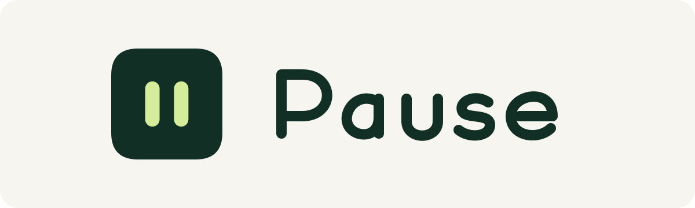

  

<h1 align="center">Un po’ meno pubblicità. Un po’ più gioco.</h1>

  Pause riduce le richieste pubblicitarie in giochi, app e siti nel browser Android. 
  Attiva la protezione e torna a quello che stavi facendo.

  
   
  Android 8 o successivo · Versione 0.4.0 · Senza root o account

  <a href="https://github.com/matteoawi/Pause/releases/latest/download/Pause.apk">Download diretto dell’APK</a>
  · <a href="CHANGELOG.md">Novità</a>
  · <a href="https://github.com/matteoawi/Pause/releases/latest/download/Pause-brand-kit.zip">Brand kit SVG</a>

---

### Semplice da usare. Chiara su quello che fa.

- **Un comando per iniziare.** Attiva la protezione o mettila in pausa dalla Home.
- **Copertura più ampia, stesso setup.** StevenBlack e HaGeZi Normal già incluse. Le liste si aggiornano anche automaticamente mentre la protezione è attiva.
- **Il risultato si vede.** Totale, attività di oggi, ultimi sette giorni e app di origine quando Android le identifica. I numeri contano richieste bloccate, non annunci rimossi.
- **Come piace a te.** Italiano, inglese e spagnolo; tema chiaro, scuro o come il telefono. Animazioni dei contatori facoltative.
- **Le opzioni al posto giusto.** Esclusioni e aiuto nelle impostazioni; regole sui domini e diagnostica in Avanzate.

### Pronta in tre passaggi

1. **Scarica e installa.** Apri [Pause.apk](https://github.com/matteoawi/Pause/releases/latest/download/Pause.apk) sul telefono. Se Android lo richiede, consenti l’installazione alla fonte con cui hai aperto il file.
2. **Consenti e attiva.** Leggi la breve spiegazione iniziale e accetta il permesso VPN nella schermata Android.
3. **Torna al gioco.** Chiudilo completamente e riaprilo: gli annunci già scaricati potrebbero restare visibili. Per fermare il filtro, tocca **Metti in pausa**.

> Pause usa un filtro DNS: alcuni annunci, comprese inserzioni integrate di YouTube e Instagram, possono restare. Anche i video premio possono essere bloccati.

### Prima di scaricarla

**Perché chiede una VPN?**

Serve a creare un filtro locale sul telefono. Il traffico ordinario dei giochi resta sulla tua connessione e non passa da un nostro server VPN. Android consente una sola VPN attiva: Pause sostituisce quella eventualmente già in uso. Non attivare l’opzione Android «Blocca connessioni senza VPN».

**Quali dati usa?**

Pause non ha analytics e non legge né decifra le connessioni HTTPS. Regole, esclusioni e statistiche restano sul telefono, escluse dai backup. Gli ultimi 30 domini bloccati restano solo in memoria. Non inviamo questi dati a un nostro server.

Le richieste DNS consentite vengono inviate a **Cloudflare**, che può vedere i domini richiesti. Questo tratto DNS non è cifrato. Pause non serve a nascondere la tua identità o cambiare paese.

**Funziona con ogni annuncio?**

No. Annunci sul dominio del gioco, indirizzi IP diretti, DNS cifrato delle app e contenuti già scaricati possono superare il filtro. Se un’app non funziona o vuoi guardare un video premio, metti in pausa la protezione oppure escludi quell’app dalle impostazioni. La ricompensa dipende dal gioco.

Nelle app ufficiali di **YouTube e Instagram**, annunci e contenuti possono usare la stessa infrastruttura: il DNS non può separarli. Aprire il sito con la sola VPN di Pause non basta; serve un filtro dei contenuti nel browser, separato da Pause.

**Come aggiorno senza perdere i dati?**

Installa il nuovo APK sopra quello esistente, senza disinstallare l’app. Le release ufficiali mantengono la stessa firma e conservano regole, esclusioni e statistiche, anche dalle precedenti versioni chiamate Pausa.

Le liste cercano aggiornamenti circa ogni 24 ore **mentre la protezione è attiva**, senza nuovi permessi o passaggi iniziali. Se un tentativo fallisce, Pause conserva la lista precedente e può riprovare dopo almeno 6 ore. Puoi sempre usare **Impostazioni → Aggiorna protezione**. Non è un aggiornamento garantito a un orario fisso.

**Posso passarla a un amico?**

Sì: condividi [questo download](https://github.com/matteoawi/Pause/releases/latest/download/Pause.apk) oppure usa **Impostazioni → Condividi Pause**. L’app invia solo l’APK installato, senza le tue impostazioni o statistiche. Ogni persona autorizza la VPN sul proprio telefono.

---

  <strong>Meno interruzioni, con un gesto.</strong> 
  <a href="https://github.com/matteoawi/Pause/releases/latest/download/Pause.apk">Scarica Pause per Android</a>

  Liste incluse: <a href="https://github.com/StevenBlack/hosts">StevenBlack/hosts</a> e <a href="https://github.com/hagezi/dns-blocklists">HaGeZi Normal</a>. Licenze nell’app; <a href="filters/README.md">dati originali HaGeZi, GPLv3 e fonti</a> disponibili separatamente.

